[English](bosses.md) · **Polski**

# Bossowie

Każdy poziom kampanii kończy się bossem. Poziomów jest dwanaście, w czterech
regionach po trzy, i każdy region ma własnego bossa. Wszyscy czterej są
zbudowani i narysowani i są coraz trudniejsi w kolejności, w jakiej ich
spotykasz.

> **Wydanie v0.3.0 zawiera poziom 1, który kończy się na Blockade Breakerze.**
> Void Citadel, Siege Spine i Bastion przyjdą razem z kampanią, gdy dojdą
> prowadzące do nich poziomy. Ich obrazy pochodzą z wersji przeglądowych,
> które zaczynają się od bossa. Są oznaczone
> .

Poziomy trudności to **ROOKIE / PILOT / ACE**, w tej kolejności wszędzie,
gdzie podane są trzy liczby. Długość walki mierzy testowy bot gry, który
celuje w bossa, na pierwszym poziomie regionu danego bossa.
[Przeciwnicy](enemies.pl.md) mają własną stronę.

| Boss | Region | Poziomy | Znak rozpoznawczy | Walka na PILOT |
| --- | ---: | ---: | --- | ---: |
| [Blockade Breaker](#blockade-breaker) | 1 | 1-3 | dwa działa laserowe strzelające na zmianę | 93 s |
| [Void Citadel](#void-citadel-)  | 2 | 4-6 | studnia grawitacyjna | 99 s |
| [Siege Spine](#siege-spine-)  | 3 | 7-9 | pole siłowe | 106 s |
| [Bastion](#bastion-)  | 4 | 10-12 | przesuwane szyny z działkami i opancerzone zatoki | 122 s |

---

## Jak działa każdy boss

W aktualnej wersji kandydackiej po zniszczeniu ostatniej broni na chwilę
pojawia się napis `HULL BREACH`. Potem górna część bossa odlatuje w górę,
a reszta kadłuba rozrywa się na lewo i prawo, z iskrami na krawędziach,
przed podsumowaniem.

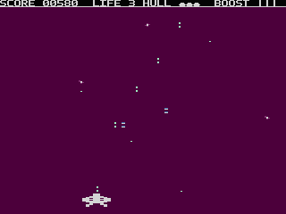

- **Nadejście.** Gdy ostatni sektor poziomu jest czysty, ekran na jedną
  trzecią sekundy czernieje. Potem pojawia się baner bossa: jego obraz,
  WARNING, jego nazwa i INCOMING, nad paskiem, który się wypełnia, gdy boss
  ładuje się z dysku. Potem boss pojawia się jako pas u góry ekranu.
- **Moduły.** Boss jest zbudowany z modułów: płyt pancernych, dział, dział
  laserowych, a niektórzy także z rdzenia.
  - Pancerz przed bronią musi paść, zanim tę broń da się trafić.
  - Kadłubu między modułami nie da się zniszczyć, a Twoje strzały się na nim
    zatrzymują.
  - Moduł błyska przy trafieniu, które przeżyje. Zniszczony moduł zostawia
    wrak.
- **Działa** strzelają impulsami prosto w dół. Każdy zabiera jedną dziesiątą
  kadłuba.
- **Działa laserowe ostrzegają przed strzałem.** Wylot działa się nagrzewa, a
  narastający dźwięk gra przez 0,8 / 0,64 / 0,5 s. Potem promień pali prosto
  w dół przez sekundę. Promień zabiera połowę kadłuba na ROOKIE i cały kadłub
  na PILOT i ACE. Działo przeładowuje się 6 / 4,5 / 3 s. Zejdź z kolumny,
  póki ostrzega.
- **Eskorta.** Od pierwszego zniszczonego działa albo działa laserowego co
  trzy do czterech sekund przylatuje Interceptor, pojedynczo, aż boss padnie
  ([eskorta bossa](enemies.pl.md#eskorta-bossa)).
- **Ostatni bój.** Na Void Citadel, Siege Spine i Bastionie każda ocalała broń
  strzela trzystrzałowymi salwami co pół swojego przeładowania, gdy padnie
  ostatni pancerz. Blockade Breaker ostatniego boju nie ma.
- **Trudność** skaluje moduły bossów: wytrzymują 0,75 raza tyle trafień na
  ROOKIE i 1,25 raza tyle na ACE. Liczby niżej dotyczą poziomu PILOT.
- **Punkty.** Każdy moduł daje punkty, gdy zostanie zniszczony. Pokonanie
  bossa dodaje **2000 punktów** premii, wypłacanej na podsumowaniu poziomu.
- **VOID LANCE.** Po 25 s każdej walki Twój myśliwiec robi się zielony: trzymaj
  Fire i joystick do przodu przez 1,5 s, a jej promień zniszczy moduł nad Tobą
  (nigdy rdzeń ani to, czego nie ranią Twoje strzały); pudło zostawia lancę.
  Ostatnia linia banera mówi, jak: `VOID LANCE: HOLD FIRE+FORWARD`
  ([jak grać](how-to-play.pl.md#void-lance)).

---

## Blockade Breaker

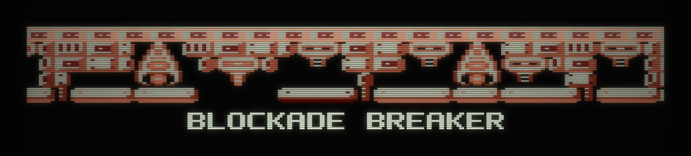

**Region 1, poziomy 1-3, pierwszy i najłagodniejszy boss.** Uszkodzony okręt
wojenny, który powoli dryfuje przez ekran tam i z powrotem.

- **Znak rozpoznawczy: dwa lasery.** Dwa działa laserowe, jedno na lewo, a
  drugie na prawo od środka, strzelają na zmianę: nigdy dwa promienie naraz.
  Zniszcz jedno, a drugie strzela dalej samo, w tym samym rytmie.
- **Moduły:**
  - Sześć dział wisi pod opancerzonym grzbietem, którego żaden strzał nie
    przebije. Jedno stoi w otwartej wnęce i strzela od początku; pozostałe
    otwierają ogień, gdy padną płyty przed nimi.
  - Pod nimi biegnie pas ośmiu płyt pancernych. Płyta musi paść, zanim da się
    trafić broń nad nią.
- **Bez ostatniego boju:** gdy pancerza już nie ma, działa nie przyspieszają.
- **Walka:** ok. 93 s na PILOT (78 s na ROOKIE, 125 s na ACE).

| Moduł | Liczba | Trafienia (PILOT) | Punkty |
| --- | ---: | ---: | ---: |
| Działo | 6 | 9 | 50 |
| Działo laserowe | 2 | 14 | 60 |
| Płyta pancerna | 8 | 4-7 | 20-30 |

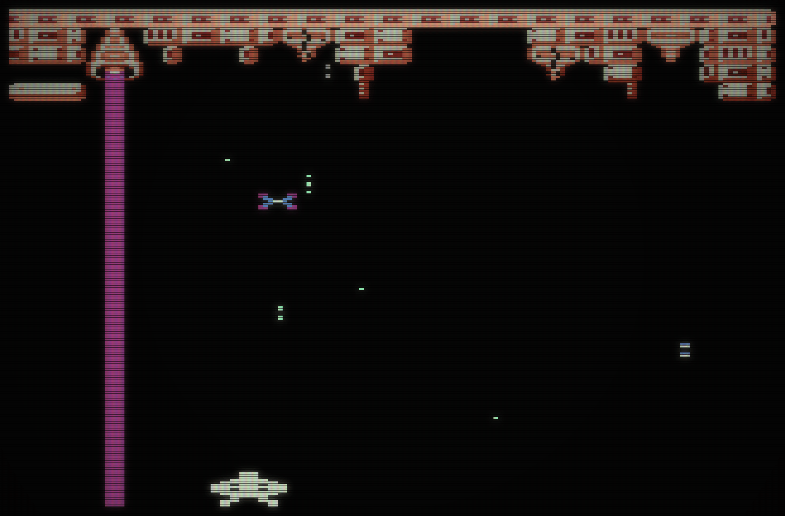

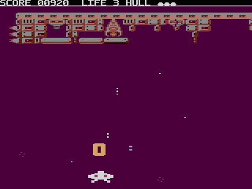

*Niszczenie, od początku walki do ostatniego wybuchu:*

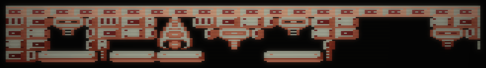
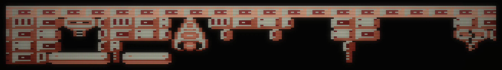
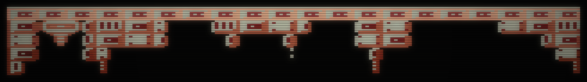
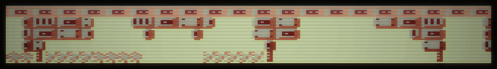

---

## Void Citadel 

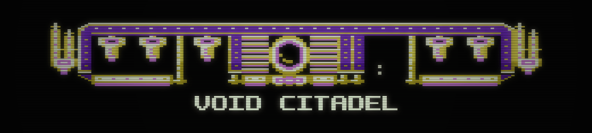

**Region 2, poziomy 4-6.** Forteca, która wisi nieruchomo na środku ekranu,
cały okręt widać naraz, z czarnym rdzeniem pustki pośrodku.

- **Znak rozpoznawczy: studnia grawitacyjna.** Dopóki stoi choć jedna z dwóch
  iglic na jej końcach, Twój statek jest ściągany w bok, ku białej kolumnie
  pod rdzeniem. Rdzeń pulsuje, kiedy ściąga. Jesteś szybszy od tego ciągu,
  ale musisz cały czas sterować przeciw niemu.
- **W kolumnie nie da się przeczekać.** Soczewka rdzenia strzela własnym
  laserem prosto w dół wzdłuż niej, a kolumna migocze, kiedy strzał się
  nagrzewa. Soczewka strzela także wtedy, gdy chronią ją iglice.
- **Zniszcz obie iglice**, a ciąg, pulsowanie i kolumna znikną od razu.
  Dopiero wtedy da się trafić soczewkę i rdzeń.
- **Od poziomu 5** strzela też działo laserowe na lewo od rdzenia. Stoi tak
  blisko, że jego promień styka się z promieniem soczewki i obok rdzenia nie
  ma luki.
  - Na poziomie 4 oba działa stoją jako żaluzjowy pancerz.
  - Prawe działo zostaje pancerzem przez poziomy 4-6.
- **Ostatni bój:** salwy z każdej ocalałej broni, gdy padnie ostatni pancerz.
- **Walka:** ok. 99 s na PILOT na poziomie 4 (84 s na ROOKIE, 126 s na ACE);
  120 s na PILOT na poziomach 5-6.

| Moduł | Liczba | Trafienia (PILOT) | Punkty |
| --- | ---: | ---: | ---: |
| Iglica (salwy) | 2 | 12 | 80 |
| Działo | 6 | 11 | 50 |
| Działo laserowe | 2 | 16 | 80 |
| Soczewka rdzenia (laser) | 1 | 27 | 99 |
| Rdzeń | 1 | 29 | 99 |
| Płyta pancerna | 4 | 11 | 20-30 |

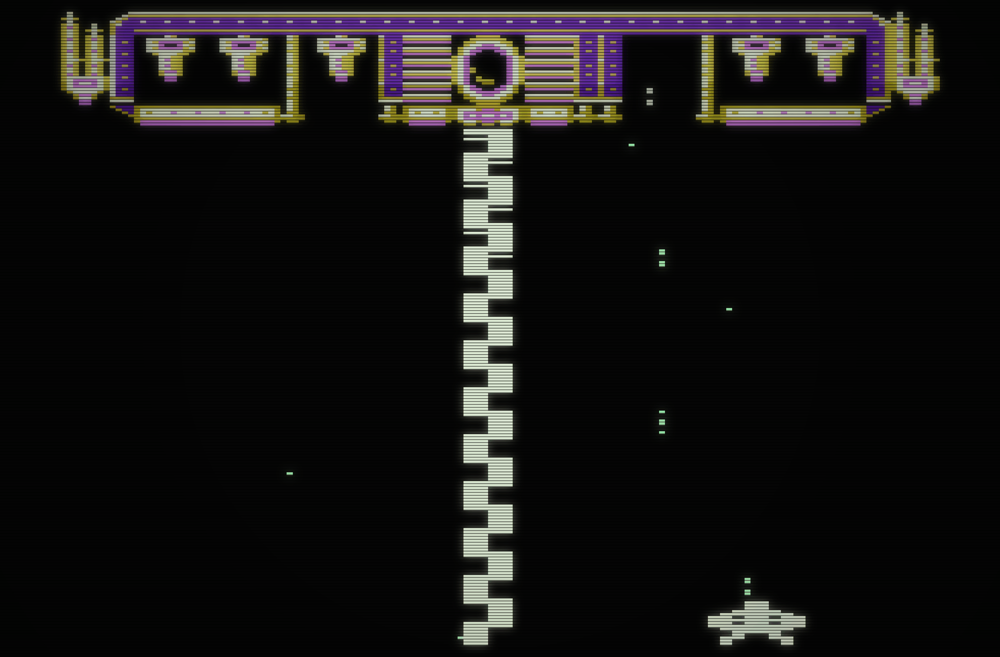

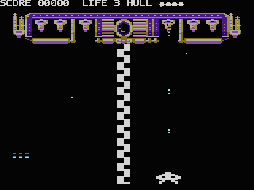

*Niszczenie:*

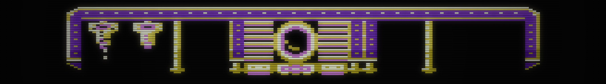
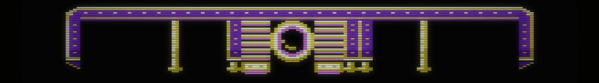
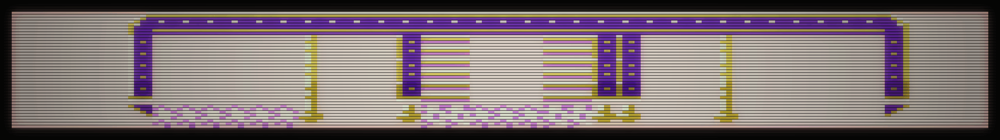

---

## Siege Spine 

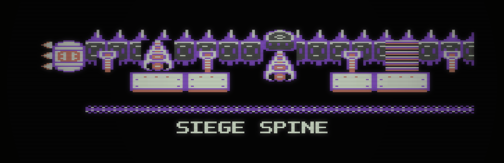

**Region 3, poziomy 7-9.** Długi, segmentowy kręgosłup z kolcami grzbietowymi
i kopulastym działem oblężniczym pośrodku. Dryfuje przez ekran tam i z
powrotem.

- **Znak rozpoznawczy: pole siłowe.** Pod kręgosłupem biegnie migocząca linia
  w dwóch połowach; Twoje strzały zatrzymują się na niej i nic nie robią.
  Każdą połowę zasila kula generatora na jej końcu okrętu. Zniszcz generator,
  a jego połowa pola zawali się kolumna po kolumnie od strony generatora.
- **Za polem:** działa i lasery strzelają przez nie przez cały czas.
- **Lasery:**
  - Środkowe działo oblężnicze strzela od początku.
  - Na poziomach 7-8 dołącza do niego jeszcze jeden emiter laserowy, na
    poziomie 9 oba.
  - Najwyżej dwa lasery naraz nagrzewają się albo strzelają.
- **Ostatni bój:** salwy z każdej ocalałej broni, gdy padnie ostatni pancerz.
- **Walka:** ok. 106 s na PILOT na poziomach 7-8 (97 s na ROOKIE, 139 s na
  ACE); 112 s na PILOT na poziomie 9.

| Moduł | Liczba | Trafienia (PILOT) | Punkty |
| --- | ---: | ---: | ---: |
| Kula generatora | 2 | 13 | 50 |
| Działo | 4 | 9 | 50 |
| Działo oblężnicze (laser) | 1 | 16 | 80 |
| Emiter laserowy | 2 | 14 | 60 |
| Płyta pancerna | 4 | 7 | 20 |

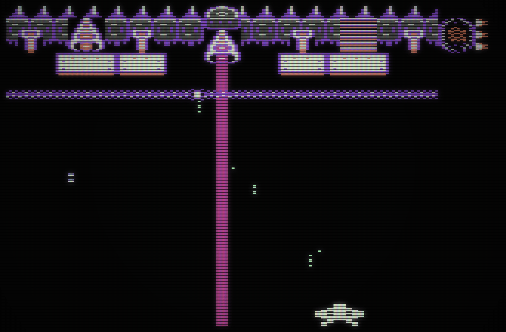

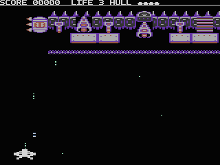

*Niszczenie:*

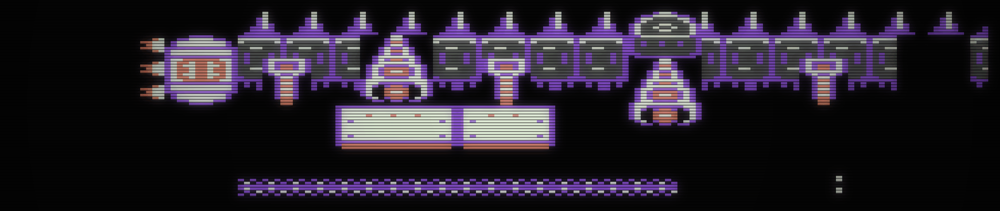
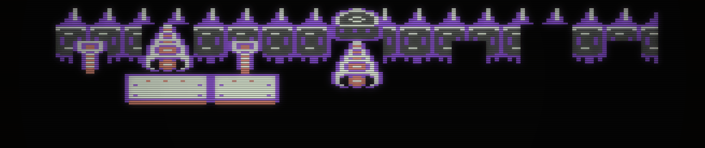
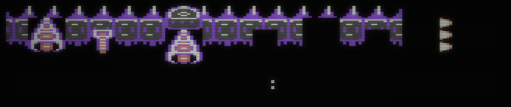
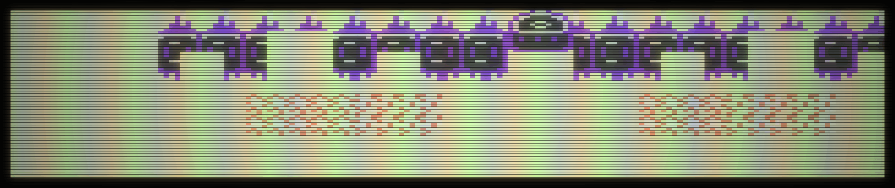

---

## Bastion 

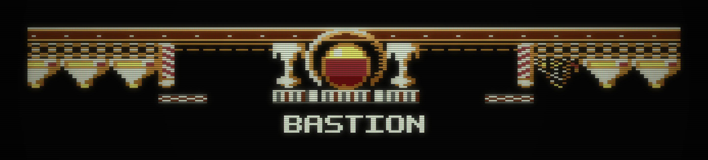

**Region 4, poziomy 10-12, ostatni boss.** Wisi nieruchomo. W jego środku jest
okrągły hangar z rdzeniem reaktora, a z bramy u jego stóp startuje eskorta.

- **Znak rozpoznawczy: szyny i zatoki.** Obok hangaru stoją dwa działa
  laserowe, każde w opancerzonej zatoce. Twoje strzały odbijają się od
  pancerza zatoki, a działo i tak strzela spod niego. Na zewnątrz każdego
  działa biegnie szyna z działkami, która wychodzi poza krawędź ekranu.
- **Szyny się przesuwają.**
  - Zniszcz przednie działko szyny, a cała szyna przesunie się o krok do
    środka.
  - **Pierwsze przesunięcie** otwiera zatokę po tej stronie: działo robi się
    żółte i teraz da się je trafić.
  - **Drugie przesunięcie** wsuwa opancerzoną stopę szyny przed działo.
    Zakrytego działa nie da się już uszkodzić, a ono strzela dalej spod stopy
    aż do końca walki.
  - Dopóki zatoka jest otwarta, działko, którego zniszczenie by ją zakryło,
    mruga.
  - **Otwórz pancerz działa, a potem zniszcz je, zanim szyna się zamknie.**
- **Brama** jest zamknięta, dopóki każde działo i każde działko szyny nie
  zostanie zniszczone albo zakryte. Wtedy otwiera się z błyskiem i dźwiękiem.
  Rozbij ją, a eskorta ustanie i rdzeń za nią będzie Twój. Szyny nigdy nie
  zakrywają hangaru.
- **Lasery:** strzelają oba działa, każde po swojemu.
- **Ostatni bój:** gdy padnie brama, rdzeń strzela salwami.
- **Walka:** ok. 122 s na PILOT (96 s na ROOKIE, 161 s na ACE).

| Moduł | Liczba | Trafienia (PILOT) | Punkty |
| --- | ---: | ---: | ---: |
| Działko szyny | 6 | 16 | 40 |
| Działo laserowe (w zatoce) | 2 | 8 | 80 |
| Brama hangaru | 1 | 24 | 60 |
| Rdzeń reaktora (salwy) | 1 | 79 | 99 |

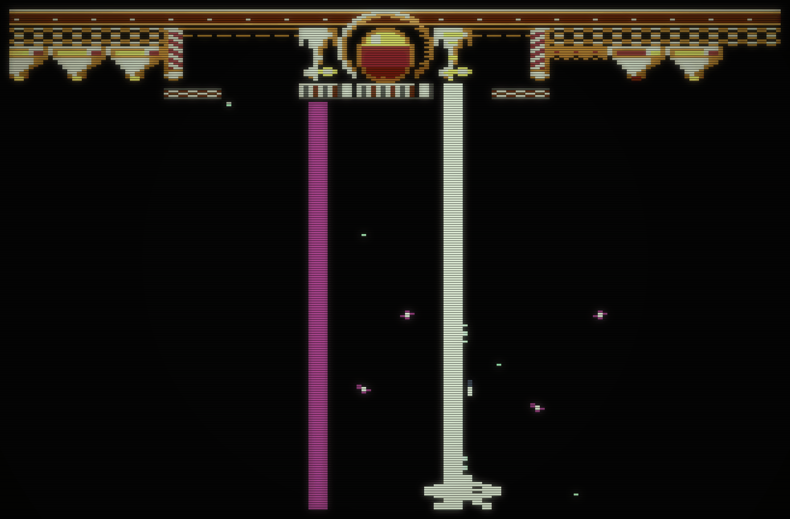

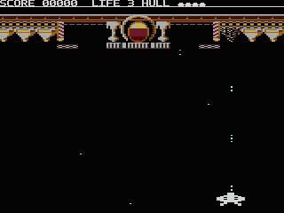

*Niszczenie:*

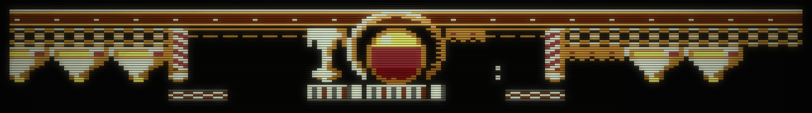
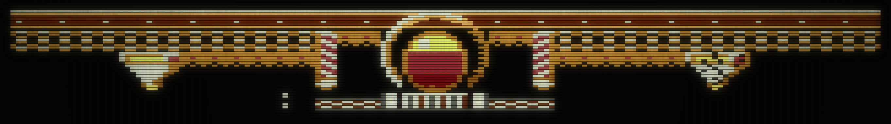
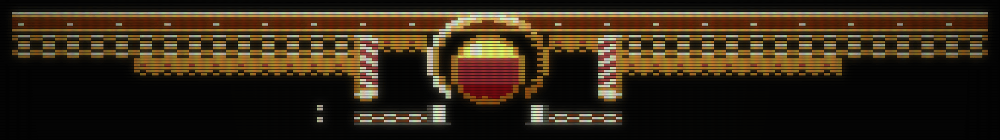
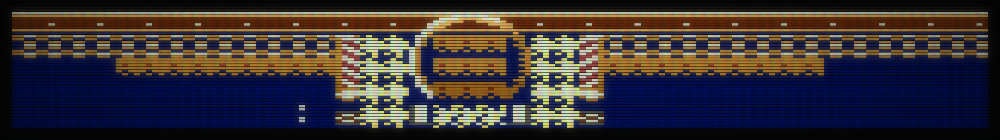

---

*Jak powstały obrazy:*

- Każdy obraz to klatka gry uruchomionej w Atari800 (PAL, PILOT):
  - Blockade Breaker na poziomie 1;
  - pozostali trzej bossowie w wersjach przeglądowych, które zaczynają się od
    bossa.
- Klatki są powiększone ośmiokrotnie, z zachowanym kształtem piksela Atari w
  PAL, i pokazane przez filtr ekranu kineskopowego.
- Narzędzia są w `scripts/pages/`; z której klatki pochodzi każdy obraz,
  zapisuje `scripts/pages/stills.json`.
