[English](enemies.md) · **Polski**

# Przeciwnicy

Wszystko, co strzela do Ciebie w Void Strike 65, tak jak gra się w wydaniu
**v0.3.0**, czyli w poziomie 1 zakończonym bossem. Liczby pochodzą z kodu i
danych gry. Obrazy to klatki samej gry, nagrane w Atari800 (PAL), powiększone
i pokazane przez filtr ekranu kineskopowego. Nic nie jest dorysowane.

Przeciwnicy dzielą się na dwie klasy:

- **Ciężkie** okręty rysują sprzętowe duszki Atari. Przylatują parami i
  zostają, dopóki ich nie zniszczysz.
- **Lekkie** myśliwce są rysowane znakami. Lecą swoją trasą i odlatują, więc
  ich zestrzeliwanie to wybór między punktami a bezpieczeństwem.

Poziom trudności wybierasz w menu: **ROOKIE**, **PILOT** albo **ACE**. Tam,
gdzie liczba niżej ma trzy wartości, dotyczą one tych trzech poziomów w tej
kolejności. Przeciwnik wytrzymuje tyle samo trafień na każdym poziomie
trudności; trudność zmienia to, jak często strzela.

 oznacza to, co
jest już zbudowane, ale nie weszło do v0.3.0. Przyjdzie razem z kampanią.

Bossowie mają [własną stronę](bosses.pl.md).

| Przeciwnik | Klasa | Trafień do zniszczenia | Punkty | Broń | Gdzie na poziomie 1 |
| --- | --- | ---: | ---: | --- | --- |
| [Raider](#raider) | Ciężki | 1 | 10 | serie impulsów | pierwszy sektor, po przelocie korytarzem |
| [Bomber](#bomber) | Ciężki | 4 | 50 | pociski | pierwszy sektor, po przelocie korytarzem |
| [Wingman](#wingman) | Lekki | 1 | 5 | pojedynczy impuls | eskorta Raiderów, rój |
| [Interceptor](#interceptor) | Lekki | 3 | 15 | strzał laserowy | rój, z Raiderami, eskorta bossa |

Każdy wrogi strzał zabiera Ci jedną dziesiątą kadłuba. Wlecenie w
przeciwnika zabiera cały kadłub, chyba że działa tarcza (Shield) albo jeszcze
migasz po odrodzeniu.

---

## Ciężkie

### Raider

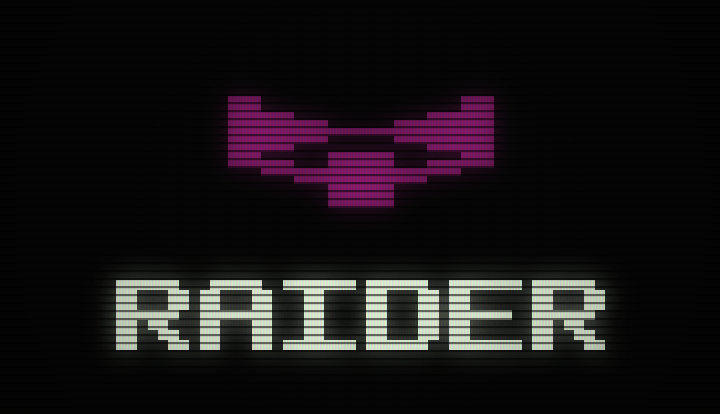

Podstawowy wrogi myśliwiec, latający parą.

- **Trafień do zniszczenia:** 1. **Punkty:** 10.
- **Broń:** para ma wspólny rytm strzałów. Wystrzeliwuje pięć impulsów co 15
  klatek, potem robi przerwę 60 / 50 / 40 klatek (1,2 / 1,0 / 0,8 s). Strzał
  spada dwie linie na klatkę i leci dalej także po zniszczeniu swojego Raidera.
- **Ruch:** oba wlatują zza górnej krawędzi ekranu i schodzą na swoje
  miejsca. Potem ścigają Cię w poziomie czytelnym zygzakiem, z prędkością 80%
  Twojej maksymalnej. Każdy skręca według własnego zegara, więc para nigdy
  nie jest swoim lustrzanym odbiciem.
- **Zderzenie:** zabiera cały kadłub; Raider dostaje jedno trafienie.
- **Gdzie:** pierwszy sektor poziomu 1 (cztery pary, każda z Wingmanem). Po
  przelocie korytarzem: para z Interceptorem i ostatnia para sama, przed
  bossem.
- **Co daje:** Raider zestrzelony Twoim strzałem liczy się do następnej
  kapsuły z ulepszeniem.

### Bomber

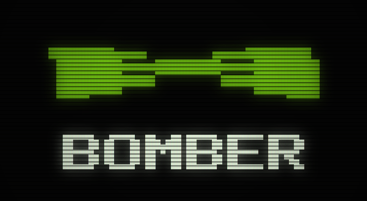

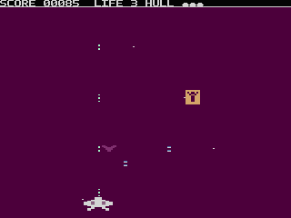

Ciężki bombowiec o sylwetce katamaranu (dwa kadłuby, jeden mostek), więc nigdy
nie wygląda jak duży Raider. Jest zielony, a tego koloru nie nosi nic innego w
tej bitwie.

- **Trafień do zniszczenia:** 4. Kadłub ciemnieje z każdym trafieniem, więc po
  kolorze poznasz, ile mu zostało; błyska przy trafieniu, które przeżyje.
- **Punkty:** 50.
- **Broń:** nalot. Bomber zatrzymuje się, jego kadłub rozjaśnia się na 20
  klatek, gdy celuje, a potem wystrzeliwuje dwa pociski co 8 klatek z tego
  samego miejsca. Przeładowanie przed następnym nalotem trwa 64 / 52 / 40
  klatek. Pocisk spada jedną linię na klatkę, o połowę wolniej niż impuls.
- **Ruch:** każdy z pary przeczesuje własny pas, jeden po lewej, drugi po
  prawej. Zawraca na brzegu pasa albo po pół sekundy do sekundy i opada o
  jedną linię co drugą klatkę.
- **Zderzenie:** zabiera cały kadłub.
- **Gdzie:** pierwszy sektor poziomu 1 (cztery pary) i jedna para po
  przelocie korytarzem.
- **Co daje:** Bomber zestrzelony Twoim strzałem liczy się do następnej
  kapsuły.

---

## Lekkie

### Wingman

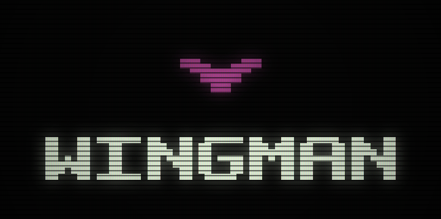

Mały myśliwiec eskorty.

- **Trafień do zniszczenia:** 1. **Punkty:** 5.
- **Broń:** jeden impuls co 96 / 80 / 64 klatki, i tylko wtedy, gdy jest w
  całości na ekranie.
- **Ruch:** jako eskorta trzyma się na środku nad swoim Raiderem i podąża za
  nim. Jeśli jego Raider zostanie zniszczony albo gdy leci w kolumnie roju,
  opada prosto w dół i opuszcza ekran.
- **Zderzenie:** zabiera cały kadłub.
- **Gdzie:** eskortuje pary Raiderów w pierwszym sektorze poziomu 1 i leci w
  dwóch kolumnach po trzy w roju po przelocie korytarzem.
- **Co daje:** nic. Lekkie myśliwce nigdy nie liczą się do kapsuły.

### Interceptor

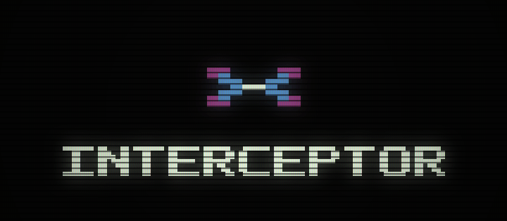

Najszybsza rzecz na ekranie i jedyny przeciwnik, który lata w górę. Nie
taranuje Cię: zawisa nad Tobą i strzela w dół.

- **Trafień do zniszczenia:** 3. Gdy przeżyje trafienie, jego czerwone
  gondole na chwilę błyskają.
- **Punkty:** 15.
- **Broń:** cienki strzał laserowy, prosto w dół i tylko wtedy, gdy jest w
  Twojej kolumnie. Między strzałami czeka 40 / 31 / 20 klatek, co daje jeden,
  dwa albo trzy strzały na jedno podejście.
- **Ruch:**
  - Nurkuje cztery linie na klatkę, aż znajdzie się siedem rzędów nad Tobą,
    potem zawisa i podąża w bok za środkiem Twojego statku.
  - Jeśli podlecisz bliżej niż na sześć rzędów, cofa się w górę.
  - Dopóki Twój strzał przecina jego kolumnę, nie przesuwa się w bok: stoi i
    strzela.
  - Po 64 klatkach (ok. 1,3 s) zawisu odlatuje w górę, za ekran, trzy linie na
    klatkę. To wolniej niż Twoje strzały, więc da się go dopaść w każdej fazie
    lotu.
  - W niektórych falach wznosi się tylko pod górną krawędź ekranu, zawisa tam
    i nurkuje z powrotem na kolejne podejście. Na poziomie 1 robi to dwa razy,
    zanim odleci.
- **Zderzenie:** zabiera cały kadłub.
- **Gdzie:** trzy w roju po przelocie korytarzem, ustawiające się jeden nad
  drugim co dwa rzędy. Jeden leci z następną parą Raiderów. Podczas walki z
  bossem są [eskortą bossa](#eskorta-bossa).
- **Co daje:** nic.

---

## Oznaczenia

Niektóre fale wysyłają Wingmana albo Interceptora z innymi oznaczeniami lub w
innym kształcie. To wciąż ten sam przeciwnik: lata, strzela, wytrzymuje
trafienia i daje punkty dokładnie tak jak jego typ.

### Wingman: flight-lead

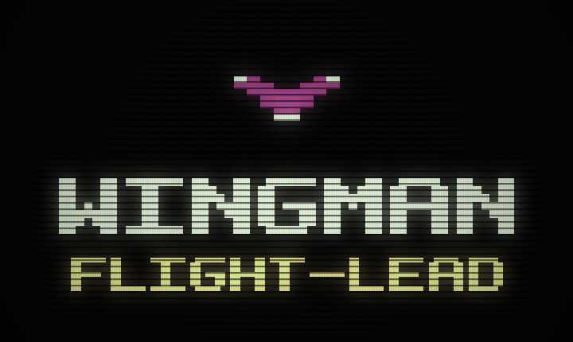

Czerwone V z białymi końcami skrzydeł i białym nosem. Prowadzi rój po
przelocie korytarzem na poziomie 1: nosi je pierwsza kolumna trzech Wingmanów.

### Wingman: escort 

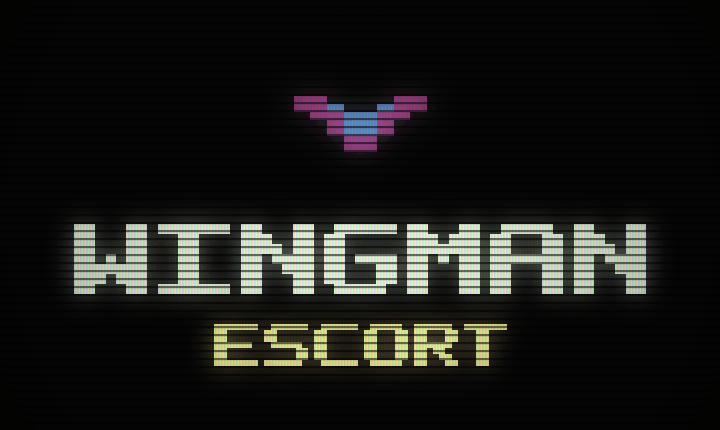

Czerwone V ze stalową wewnętrzną krawędzią. Eskortuje Bombery na poziomie 2.

### Interceptor: hunter 

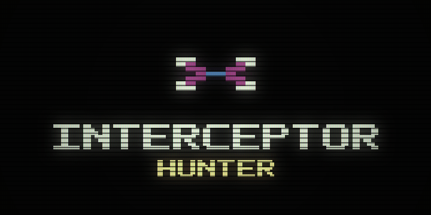

Interceptor w innych barwach: czerwone ramiona, białe gondole wirników,
stalowa piasta. Lata w rojach poziomu 2.

### Interceptor: lancer 

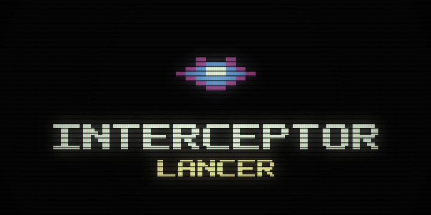

Inny kształt: grot w kształcie latawca, czerwony obrys, stalowy kadłub, biały
rdzeń. Lata w rojach poziomu 2.

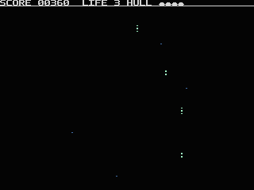

*Rój na poziomie 1, po przelocie korytarzem. Najpierw kolumna Wingmanów
flight-lead, potem trzy Interceptory, które ustawiają się nad Tobą i zawracają.*

---

## Inne zagrożenia

### Okręty liniowe

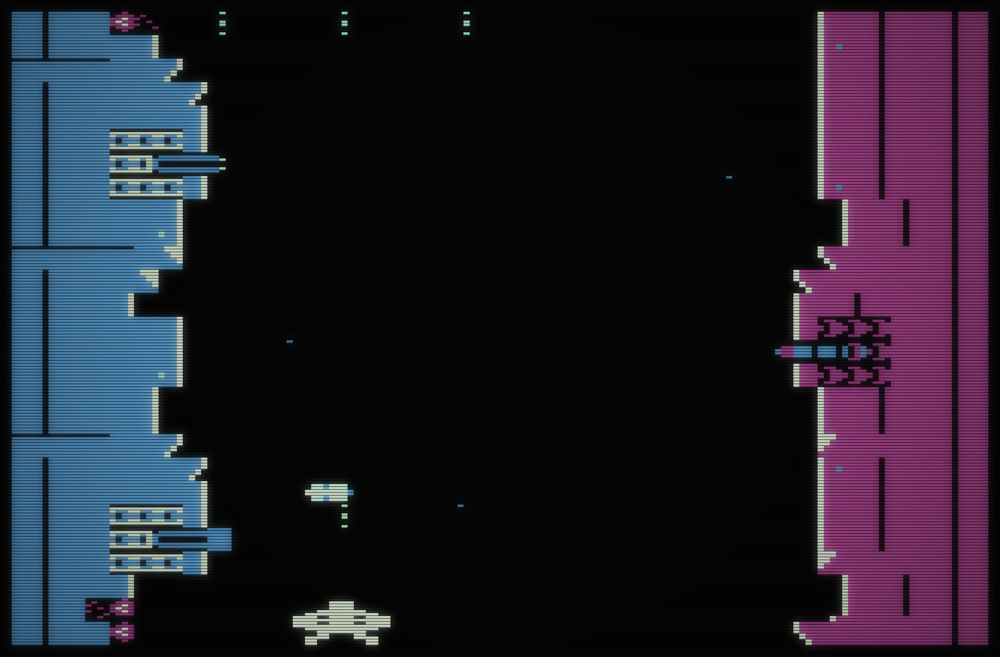

Dwa okręty liniowe walczą ze sobą, a Ty lecisz korytarzem między nimi.
Niebieski po lewej jest Twój, fioletowy po prawej należy do wroga.

- **Żadnego nie da się zniszczyć**, ich wieżyczek też nie. Omijaj je.
- **Oba strzelają salwami `BROADSIDE` i oba Cię trafiają.** Ogień Twojej
  strony jest tak samo groźny jak ogień wroga. Wieżyczka ostrzega przez pół
  sekundy (25 klatek) i błyska przez 4 klatki, zanim wystrzeli.
- Pocisk albo wlecenie w kadłub zabiera **dwie dziesiąte** Twojego kadłuba.
- Kadłub na poziomie 1 ma 10 / 15 / 20 stanowisk wieżyczek, zależnie od
  trudności.
- **Gdzie:** drugi sektor poziomu 1. Gdy lecisz korytarzem, nie wlatuje do
  niego żaden wrogi myśliwiec.

### Szczątki

Koziołkujące wraki, przez cały poziom.

- **Trafień do zniszczenia:** 3. **Punkty:** 25, czy je zestrzelisz, czy w
  nie wlecisz.
- **Zderzenie:** zabiera 2 / 5 / 7 dziesiątych Twojego kadłuba.
- **Co dają:** szczątki zestrzelone Twoim strzałem liczą się do następnej
  kapsuły; staranowane nie.

### Eskorta bossa

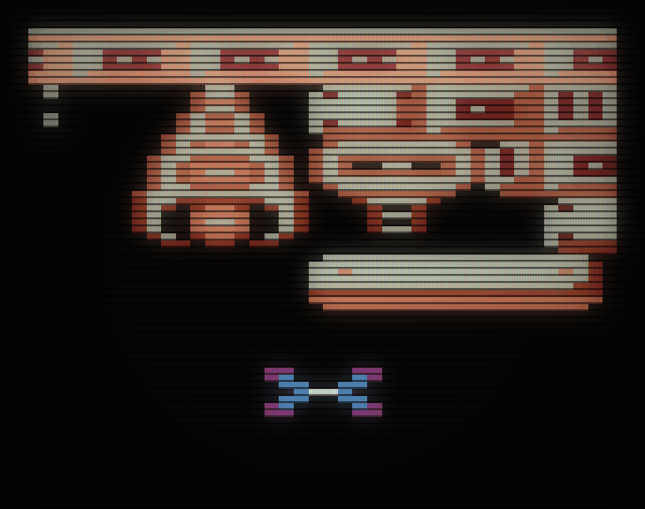

Podczas walki z bossem Interceptory przylatują pojedynczo. Pierwszy pojawia
się, gdy zniszczysz pierwsze działo albo pierwsze działo laserowe bossa (pancerz
się nie liczy). Potem przylatuje jeden co trzy do czterech sekund, aż boss
padnie. Nigdy nie ma więcej niż jednego naraz i żaden nie przylatuje po
zniszczeniu bossa.

Interceptor eskorty robi jedno podejście i odlatuje; nie zawraca. Na Bastionie
startuje z bramy hangaru, a eskorta ustaje, gdy brama zostanie zniszczona.

---

## Kapsuły

Co trzecie zaliczone zestrzelenie wypuszcza kapsułę z ulepszeniem: Rapid Fire,
potem Spread Shot, potem Shield i od nowa. Zestrzelenie się liczy, gdy Twój
strzał zniszczy **ciężki** okręt (Raidera albo Bombera) albo **szczątek**.
Lekkie myśliwce, taranowanie i zniszczenia ogniem okrętów liniowych się nie
liczą.

---

*Jak powstały obrazy:*

- Każdy obraz to klatka gry uruchomionej w Atari800 (PAL, PILOT):
  - poziom 1 dla wszystkiego z wydania v0.3.0;
  - przeglądowa wersja poziomu 2 dla oznaczeń escort, hunter i lancer.
- Klatki są powiększone ośmiokrotnie, z zachowanym kształtem piksela Atari w
  PAL, i pokazane przez filtr ekranu kineskopowego.
- Narzędzia są w `scripts/pages/`; z której klatki pochodzi każdy obraz,
  zapisuje `scripts/pages/stills.json`.
